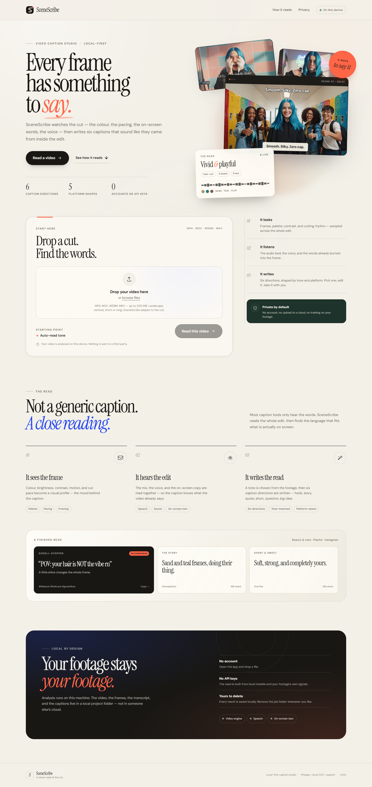
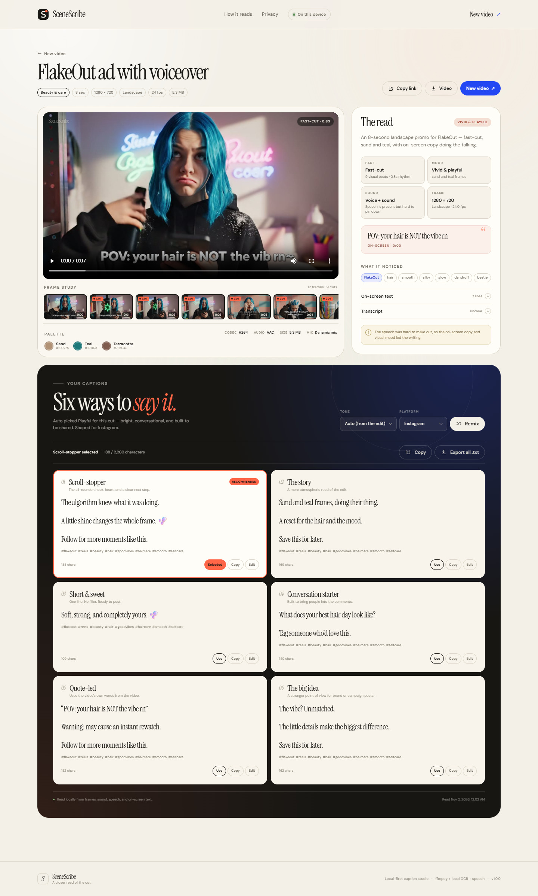

# SceneScribe Studio

**Every frame has something to say.**

A local-first video caption studio unified with ClipForge. ClipForge turns long YouTube/Twitch videos into short clips, and SceneScribe reads each clip’s frames, audio, speech, and on-screen text to generate six platform-shaped caption directions. Everything runs locally — no accounts, no cloud AI, no footage uploads. Built with Python, Starlette, FFmpeg, faster-whisper, RapidOCR, and a custom editorial web UI.

SceneScribe is a local-first video caption studio, now unified with ClipForge. Drop in a cut and it watches the frames, listens to the mix and voice, reads the words already on screen, then writes six caption directions that belong to that specific edit. You can also start from a YouTube or Twitch link: ClipForge cuts the replayable moments into a clip deck, and each clip opens in the same caption studio.

No account. No API key. No footage sent to a cloud service.



## What it does

- **Reads the picture** — samples frames across the whole cut, profiles palette, contrast, motion, and cutting rhythm.
- **Reads the sound** — separates speech from the rest of the mix and describes the audio bed.
- **Reads the screen** — runs local OCR over the sampled frames to catch hooks, titles, and product copy.
- **Finds the shape** — resolves the topic, brand, mood, pace, quote, and keywords.
- **Writes six directions** — scroll-stopper, story, short, quote-led, conversation starter, and big idea.
- **Shapes for the platform** — Instagram, TikTok, YouTube Shorts, LinkedIn, or X, with platform-aware hashtags and character limits.
- **Keeps it editable** — remix the tone or platform, edit a caption inline, copy one, or export all six as a text file.



## Requirements

- **Python 3.12+**
- **ffmpeg and ffprobe** on `PATH` (or set the environment variables below)
- **ClipForge** installed in a sibling folder, or pointed to with `SCENESCRIBE_CLIPFORGE_HOME`, if you want link-to-clip generation. ClipForge keeps its own Python virtualenv; SceneScribe invokes it as a subprocess.
- About **1.5 GB** of free disk space for the SceneScribe Python environment and the first speech-model download
- A modern browser with MP4/H.264 playback support for the built-in preview

On Windows, install ffmpeg with:

```powershell
winget install Gyan.FFmpeg
```

Then open a new terminal so `ffmpeg` is available on `PATH`.

ClipForge is discovered automatically when it lives at a sibling path such as `C:\\Users\\you\\clipforge`. Override that with `SCENESCRIBE_CLIPFORGE_HOME` or `SCENESCRIBE_CLIPFORGE_PYTHON`.

## Quick start

From this folder:

```powershell
.\run.ps1
```

The first run creates `.venv`, installs dependencies, and starts the studio at <http://127.0.0.1:8000>. Later runs start immediately. Use `.\run.ps1 -Port 8080` to change the port or `.\run.ps1 -NoBrowser` to skip opening a browser.

### Manual setup

```powershell
py -3.12 -m venv .venv
.\.venv\Scripts\python.exe -m pip install -r requirements.txt
.\.venv\Scripts\python.exe -m uvicorn app:app --host 127.0.0.1 --port 8000
```

Then open <http://127.0.0.1:8000>.

## Using the studio

1. To caption a video you already have, drop an MP4, MOV, M4V, WEBM, MKV, or AVI file, or browse to one.
2. Choose **Read this video**. Analysis runs as a background job and the page polls for progress.
3. To start from a long video, open **ClipForge**, paste a YouTube or Twitch link or a local path, choose the clip count, length, shape, and framing, then **Forge clips**.
4. Review the clip deck. Each clip keeps its video, thumbnail, and metadata in the local run folder.
5. Choose **Write captions** on a clip to hardlink it into a normal SceneScribe job and open the caption studio. The studio shows a **Back to clip deck** link when the read came from ClipForge.
6. In the studio, check the read, scrub through the sampled frames, and inspect the on-screen text and transcript.
7. Change **Tone** or **Platform** to remix automatically, or press **Remix** for a new phrasing of the same read.
8. Select a direction, edit it inline, copy it, download the video, or export every direction as `.txt`.
9. **Copy link** creates a deep link such as `/?job=<id>` or `/?job=<id>&clips=<run-id>`. The saved result is read back from disk, so it survives a server restart.

Analysis is capped at 30 minutes of footage by default. For longer videos, raise `SCENESCRIBE_MAX_ANALYSIS_SECONDS` or trim the clip first.

## How it works

```text
video
  │
  ├─ ffprobe ─────────────── metadata, codecs, duration, orientation
  ├─ ffmpeg frame samples ── palette, contrast, motion, cut pacing
  ├─ ffmpeg audio extract ── waveform energy, silence, mix character
  ├─ RapidOCR ────────────── burned-in hooks, titles, captions
  └─ faster-whisper ──────── speech segments, language, confidence
        │
        ▼
  semantics: topic, mood, pace, quote, brand, keywords, summary
        │
        ▼
  writer: six deterministic caption directions + platform hashtags
```

The caption writer is local and deterministic. It is not a remote language model: it builds a caption from the measured edit, the topic profile, the strongest quote, and a seeded phrase selection. The same video, tone, platform, and seed produce the same result. Remixing changes the seed and the phrase choices. If speech or OCR is unavailable, the read falls back to visual signals and clearly says so.

### The six directions

| Direction | Point of view |
| --- | --- |
| Scroll-stopper | Hook, heart, and a clear next step. Selected by default. |
| The story | A more atmospheric read of the edit. |
| Short & sweet | One line, no filler, ready to post. |
| Conversation starter | A question built for the comments. |
| Quote-led | Built around the video's own speech or on-screen copy. |
| The big idea | A stronger point of view for a brand or campaign. |

## Privacy and local data

Every uploaded file, extracted frame, audio track, and result stays under:

```text
data/jobs/<job-id>/
├── source.mp4
├── audio.wav
├── frames/
│   ├── frame_01.jpg
│   └── ...
└── result.json

data/clip_runs/<run-id>/
├── run.json
└── output/
    └── <video-name>/
        ├── clips.json
        ├── clips/
        │   ├── clip_01.mp4
        │   └── ...
        └── thumbnails/
```

Delete a job folder or clip-run folder to remove that video and all derived analysis. Nothing is sent to a third party. The first speech run downloads the selected Whisper model from Hugging Face; after that, inference runs locally. Set `SCENESCRIBE_DATA_DIR` to move the whole store elsewhere.

ClipForge runs are persisted under `data/clip_runs/<run-id>/`. Generated clips stay ClipForge outputs until you choose **Write captions**, which hardlinks one clip into a normal SceneScribe job so the existing studio and deep links work unchanged.

The server binds to `127.0.0.1` by design. Do not expose it to an untrusted network: it has no authentication.

## Configuration

All settings are environment variables. Set them before starting the server.

| Variable | Default | Purpose |
| --- | --- | --- |
| `SCENESCRIBE_DATA_DIR` | `./data` | Where uploads, frames, and results are stored. |
| `SCENESCRIBE_MAX_UPLOAD_MB` | `500` | Maximum upload size in MB. |
| `SCENESCRIBE_FRAME_COUNT` | `12` | Target number of sampled frames. |
| `SCENESCRIBE_MAX_ANALYSIS_SECONDS` | `1800` | Audio/speech analysis limit in seconds. |
| `SCENESCRIBE_FFMPEG_TIMEOUT` | `300` | Per-command ffmpeg timeout in seconds. |
| `SCENESCRIBE_FFMPEG` | auto | Explicit path to `ffmpeg`. |
| `SCENESCRIBE_FFPROBE` | auto | Explicit path to `ffprobe`. |
| `SCENESCRIBE_ENABLE_OCR` | `1` | Set to `0` to skip on-screen text. |
| `SCENESCRIBE_OCR_MIN_CONFIDENCE` | `0.55` | Minimum OCR confidence to keep a line. |
| `SCENESCRIBE_ENABLE_SPEECH` | `1` | Set to `0` to skip speech recognition. |
| `SCENESCRIBE_WHISPER_MODEL` | `base` | `tiny`, `base`, `small`, `medium`, or `large-v3`. |
| `SCENESCRIBE_WHISPER_DEVICE` | `cpu` | `cpu` or `cuda`. |
| `SCENESCRIBE_WHISPER_COMPUTE_TYPE` | `int8` | faster-whisper compute type, for example `int8` or `float16`. |
| `SCENESCRIBE_WHISPER_BEAM_SIZE` | `3` | Decoding beam size. |
| `SCENESCRIBE_WHISPER_TRANSLATE` | `0` | Translate speech to English when `1`. |
| `SCENESCRIBE_MAX_WORKERS` | `2` | Number of concurrent analysis jobs. |
| `SCENESCRIBE_CLIPFORGE_HOME` | auto | Folder containing the ClipForge project. Defaults to a sibling `clipforge` folder. |
| `SCENESCRIBE_CLIPFORGE_PYTHON` | auto | Python executable inside ClipForge's own virtualenv. |

Example:

```powershell
$env:SCENESCRIBE_WHISPER_MODEL = "small"
$env:SCENESCRIBE_MAX_UPLOAD_MB = "1000"
.\run.ps1
```

## API

The frontend uses the same small local API that is available to scripts:

| Method | Route | Purpose |
| --- | --- | --- |
| `GET` | `/api/health` | Capabilities, limits, tone and platform options. |
| `POST` | `/api/analyze` | Multipart upload with fields `video`, `tone`, `platform`; returns `202` and a job ID. |
| `GET` | `/api/jobs/{id}` | Job status, progress, stage, warnings, and result. |
| `POST` | `/api/jobs/{id}/remix` | JSON `{tone, platform, seed}`; rebuilds the caption set. |
| `GET` | `/api/jobs/{id}/video` | Range-capable local video stream. Add `?download=1` to download. |
| `GET` | `/api/jobs/{id}/frames/{file}` | Sampled JPEG frame. |
| `POST` | `/api/clip-runs` | Start a ClipForge run from JSON `{source, count, duration, aspect, reframe, mode, captions, hook}`. |
| `GET` | `/api/clip-runs/{id}` | Clip run status, progress, stage, log, and clip deck. |
| `POST` | `/api/clip-runs/{id}/cancel` | Request cancellation. |
| `POST` | `/api/clip-runs/{id}/open-folder` | Open the run's output folder locally. |
| `POST` | `/api/clip-runs/{id}/clips/{index}/caption` | Create or reuse a SceneScribe caption job for that clip. |
| `GET` | `/api/clip-runs/{id}/clips/{index}/{video|thumbnail}` | Serve a clip or thumbnail. Add `?download=1` to download. |

Example:

```powershell
$response = curl.exe -s -F "video=@C:\path\to\clip.mp4" -F "tone=auto" -F "platform=instagram" http://127.0.0.1:8000/api/analyze
$response | ConvertFrom-Json
```

Poll `GET /api/jobs/<id>` until `status` is `complete` or `error`.

## Development

Install the development extras and run the unit tests:

```powershell
.\.venv\Scripts\python.exe -m pip install -r requirements-dev.txt
.\.venv\Scripts\python.exe -m pytest -q
```

The tests cover formatting helpers, filename and JSON safety, the deterministic caption writer, semantic analysis, API validation, health/capability responses, and ClipForge route validation. The browser flow was checked with Playwright against Chrome: upload, poll, studio render, frame and Range playback, tone/platform remix, inline edit, copy, export, share, deep link, mobile layouts, ClipForge deck, caption handoff, and deck navigation.

### Project layout

```text
app.py                 Starlette routes, uploads, security headers
core/config.py         environment and paths
core/media.py          ffprobe, frame sampling, palette, audio profile
core/vision.py         local OCR over sampled frames
core/transcribe.py     faster-whisper speech recognition
core/semantics.py      topic, mood, quote, keywords, summary
core/writer.py         six caption directions and platform shaping
core/pipeline.py       end-to-end analysis orchestration
core/jobs.py           background jobs and persisted deep links
core/clipforge.py      ClipForge discovery, run store, subprocess orchestration
core/utils.py          formatting and JSON helpers
static/                editorial studio UI, local fonts, demo art
tests/                 focused unit and API tests
```

## Known limits

- The built-in `<video>` preview relies on the browser's codec support. The download link and server-side analysis work independently of browser playback.
- HEVC or unusual codecs may analyze correctly but not preview in Chrome.
- The speech model downloads on first use and can take a while on a slow connection.
- OCR is optimized for clear burned-in type, not handwriting or tiny disclaimers.
- The writer creates deliberate, platform-shaped captions; it is not a fact-checker or a replacement for reviewing the final post.
- ClipForge can burn speech captions into clips, but leave that off when you want SceneScribe to read clean frames first.
